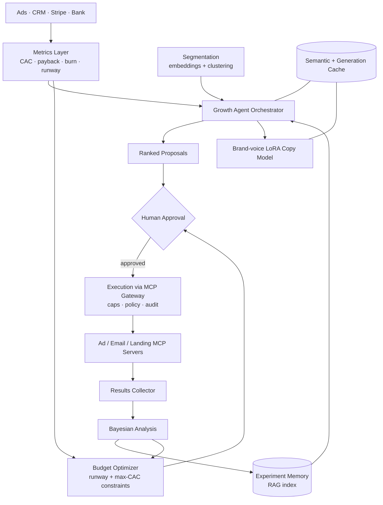

# GrowthOS: System Architecture

> An autonomous growth-experiment agent that proposes, launches and analyses marketing experiments under CAC and burn guardrails, with human approval on every spend.
>
> **Concepts:** `CAC`, `Burn Rate`, `LLMs`, `MCP`, `RAG`, `Embeddings`, `LoRA`, `Caches`

## 1. High-Level View

A metrics layer computes CAC/burn. An agent orchestrator runs the research → propose → approve → execute → analyse loop using RAG memory, a segmentation service, a LoRA copy model and MCP tools behind a policy gateway. Guardrail and budget optimisers constrain all spend decisions.

## 2. Components

| Component | Responsibility |
|---|---|
| Metrics layer | Channel/variant CAC, payback, runway projections. |
| Experiment memory | Structured experiment records + narrative learnings; hybrid retrieval. |
| Growth agent | Claude with tools: search_memory, get_metrics, segment_info, draft_copy, create_campaign (approval-gated). |
| Segmentation | Embeds firmographics + behaviour text; HDBSCAN; persona summaries. |
| Copy model | Base LLM + brand LoRA; compliance filter. |
| MCP gateway | Spend caps, paused-by-default creation, audit. |
| Bayesian analyser | Posterior over conversion/CAC per variant; decision rules. |
| Budget optimiser | Constrained allocation across channels. |

## 3. Request / Data Flow

1. Weekly: agent pulls metrics + retrieves similar past experiments + segment insights.
2. Generates and ranks proposals with expected value and cost.
3. Human approves → agent builds campaigns via MCP (paused) → human confirms go-live.
4. Results stream in → Bayesian analysis → stop/continue/scale recommendations.
5. Learnings written back to memory; budget optimiser proposes reallocation within runway policy.

## 4. Data Stores

| Store | Holds | Why |
|---|---|---|
| Postgres | Experiments, approvals, audit | System of record. |
| pgvector | Memory + segment embeddings | Retrieval. |
| Warehouse | Metrics | Analytics. |
| Redis | Caches | Cost/latency. |

## 5. Deployment Topology

- Web app + agent workers; MCP servers as sidecars.
- LoRA served via vLLM or provider fine-tune endpoint.

## 6. Scaling Strategy

- Per-company agents; scheduled runs; caching of repeated research.

## 7. Security & Privacy

- Ad-platform tokens in vault; MCP gateway enforces caps.
- Role-based approvals (marketer vs CFO thresholds).

## 8. Observability

- Agent traces, proposal outcomes, spend vs caps, guardrail checks.

## 9. Failure Modes

| Failure | Detection | Response |
|---|---|---|
| CAC spike on live campaign | Anomaly detector | Auto-pause (if allowed) + alert. |
| Ad API error during set-up | Tool error | Rollback partial resources; report. |
